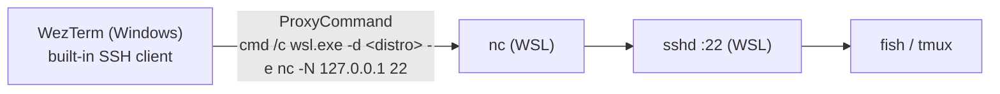

# WSL terminal over SSH design

## Context

On Windows, WezTerm opens WSL through its WSL domain, which runs `wsl.exe`
under ConPTY. Image previews in mxt and iamb break on that path in every
protocol (Sixel, Kitty, iTerm2), so mxt falls back to half blocks (#65). The
same programs draw images when the mac's WezTerm reaches this WSL machine over
SSH: mxt picks iTerm2 from WezTerm's XTVERSION reply, and iamb is pinned to
iTerm2 (#64).

Findings (2026-11-22):

- The Windows WezTerm is `20230712-072601-f4abf8fd`. Its bundled `conpty.dll`
  and `OpenConsole.exe` date from 2023-07-12, before ConPTY 1.22. ConPTY before
  1.22 parses the child's output into the console buffer and renders that
  again: it drops the Kitty graphics APC and drops or filters Sixel DCS
  ([noctty's measurements](https://zenn.dev/nanasess/articles/noctty-wsl-terminal-contribution),
  [byte capture in senpi#3596](https://github.com/code-yeongyu/senpi/issues/3596)).
  ConPTY 1.22 forwards the bytes. WezTerm bundles 1.22 since
  [wezterm@4accc376f](https://github.com/wezterm/wezterm/commit/4accc376f)
  (2025-02-08), which only nightly builds contain.
- mxt's `auto` picks half blocks whenever `WSL_DISTRO_NAME` is set and neither
  `SSH_CONNECTION` nor `SSH_TTY` is (`choose` in
  `crates/mxt-tui/src/image_protocol.rs`).
- sshd already runs under systemd in this WSL. The sessions it starts have no
  `WSL_DISTRO_NAME` or `WSL_INTEROP`, but a process under systemd without
  `WSL_INTEROP` still runs `cmd.exe`, so wslu keeps working.
- `cmd.exe /c "wsl.exe -d <distro> -e nc 127.0.0.1 22"` returns sshd's banner:
  `wsl.exe` relays its standard input and output as pipes, without ConPTY.
- WezTerm's SSH client runs `ProxyCommand` with `%COMSPEC% /c` on Windows
  (`wezterm-ssh/src/sessioninner.rs`), and reads `~/.ssh/config` with
  `IdentityFile` and `UserKnownHostsFile`. `wezterm.default_ssh_domains()`
  names the plain SSH domain of a host `SSH:<host>` (`config/src/ssh.rs`).
- The Windows user name and the WSL user name differ on this machine, so the
  SSH user has to be written out.

## Goals

- Windows WezTerm reaches WSL without ConPTY, on the same kind of path as the
  mac, so mxt (`auto`) and iamb (iTerm2) draw images.
- Machine-local values (user name, distro name, keys) stay out of the
  repository.
- A machine that is not set up keeps opening WSL as it does today.
- Setup is a chezmoi run script that is safe to run twice.

## Non-goals

- The wrong image size when two terminals with different cell sizes are
  attached to one tmux session: whichever answers the cell-size query first
  wins. It happens on every path and is tracked separately.
- Changing `sshd_config`.
- Updating the Windows WezTerm.
- Images from Windows programs, which still run under ConPTY.

## Design

### Path



The connection uses WezTerm's built-in SSH client, not `ssh.exe`: WezTerm
would run `ssh.exe` in a local pane, under ConPTY again. `wsl.exe` in the
`ProxyCommand` starts WSL when it is stopped and keeps it running while the
connection is open, so the path does not depend on `localhostForwarding`.
GlazeWM keeps starting `wezterm-gui.exe` at login as before.

### `dot_config/wezterm/wezterm.lua`

In the Windows branch, set `ssh_domains` to `wezterm.default_ssh_domains()`,
which reads `%USERPROFILE%\.ssh\config`. When it contains `SSH:wsl`, make that
the `default_domain`. Otherwise keep today's default, the first WSL domain.
The WSL domains stay registered either way, so the launcher can still open one.

### `run_onchange_after_37-setup-windows-wezterm-ssh.sh.tmpl`

The template renders only on WSL (`.chezmoi.kernel.osrelease` contains
`microsoft`, as in the mxt config), so a test can render it for WSL on any
machine. When `wslvar`, `wslpath`, `nc`, `ssh-keygen` or `ssh-keyscan` is
missing, it warns and exits 0. Steps:

1. Check sshd with `ssh-keyscan 127.0.0.1`: when it prints nothing, warn and
   exit 0 without writing anything. The template embeds the result of
   `lookPath "sshd"`, so installing openssh-server later changes the rendered
   script and chezmoi runs it again.
2. Resolve the Windows home with `wslvar USERPROFILE` and `wslpath`, the distro
   from `wslpath -w /` (`\\wsl.localhost\<distro>\`; SSH sessions have no
   `WSL_DISTRO_NAME`, and `chezmoi apply` will run in one after the switch),
   and the user with `id -un`.
3. Read `%USERPROFILE%\.ssh\config`. When it defines `Host wsl` outside the
   markers below (CRLF lines included), or its markers do not pair up, warn
   and exit 0 without writing anything.
4. Create `%USERPROFILE%\.ssh\wezterm_wsl_ed25519` with Linux `ssh-keygen` and
   no passphrase when the key or its `.pub` is missing (`ssh-keygen -y` refuses
   a key on `/mnt/c`, whose mode reads 0777, so a lost `.pub` means a new
   pair). The key grants nothing new: the same Windows user already gets a
   shell through `wsl.exe` without credentials.
5. Add its public key to `~/.ssh/authorized_keys` with
   `from="127.0.0.1,::1"`, once, matched by the key itself, so the key does
   not work over the LAN.
6. Write what `ssh-keyscan` printed, sorted, to
   `%USERPROFILE%\.ssh\known_hosts_wezterm_wsl`, so the first connection asks
   nothing. `ssh-keyscan` asks for each key type at once and prints them in
   the order they answer, which changes between runs.
7. Write this block into `%USERPROFILE%\.ssh\config`, creating the file when it
   is missing. The script fills in the two values in angle brackets.

   ```
   # >>> dotfiles: wezterm-wsl >>>
   # Written by dotfiles (run_onchange_after_37-setup-windows-wezterm-ssh.sh).
   # WezTerm opens WSL through this host so its output skips ConPTY.
   Host wsl
     HostName 127.0.0.1
     User <WSL user>
     IdentityFile ~/.ssh/wezterm_wsl_ed25519
     IdentitiesOnly yes
     UserKnownHostsFile ~/.ssh/known_hosts_wezterm_wsl
     ProxyCommand wsl.exe -d <distro> -e nc -N 127.0.0.1 22
   # Options below apply to every host again.
   Host *
   # <<< dotfiles: wezterm-wsl <<<
   ```

   A marked block already in the file is replaced where it is. A new block
   goes at the top: ssh takes the first value it finds for each option, so a
   `Host *` later in the file cannot override `User`. The closing `Host *`
   keeps options that sat at the top of the file applying to every host.
   `nc -N` closes the connection when WezTerm closes the pipe, so `wsl.exe`
   and `nc` do not linger. Files are rewritten only when their content
   changes.

### `run_once_before_10-install-apt-packages.sh.tmpl`

Add `openssh-server` and `netcat-openbsd`. The changed content makes chezmoi
run the script once more. On a new machine openssh-server listens on every
address of the WSL VM; with WSL's default NAT networking only the Windows host
reaches it. Mirrored networking exposes it further, which this design leaves
to `sshd_config` on that machine.

### Unchanged

- mxt: over SSH, `auto` asks XTVERSION and picks iTerm2 for WezTerm; inside
  tmux it decides from tmux's answer. An already running tmux server keeps
  `WSL_DISTRO_NAME` in its panes, but tmux's default `update-environment`
  copies `SSH_CONNECTION` from the attaching client, so mxt still sees SSH.
- iamb: pinned to iTerm2 since #64.

### Documentation

- `docs/wezterm.md`: the path and why (ConPTY before 1.22), what the setup
  script writes, the fallback, and the way in when sshd is down.
- `docs/current-state.md`.
- README: the note that yazi shows images on WSL only through `wezterm ssh`.

## Failure handling

| Situation | Behavior |
|---|---|
| Not set up (no `Host wsl`) | `wezterm.lua` keeps the WSL domain, as today |
| sshd not running when the script runs | Warns and writes nothing |
| `Host wsl` outside the markers, or markers that do not pair up | Warns and writes nothing |
| sshd stops later | The WezTerm window shows the connection error; Windows Terminal or `wsl.exe` still opens WSL (documented, no new key binding) |
| WSL reinstalled | chezmoi's state lives in WSL, so the script runs from scratch and reuses the Windows key |
| All WezTerm windows closed | `wsl.exe` exits, so WSL stops under the same conditions as today |

## Verification

Automated:

- `scripts/test-windows-wezterm-ssh.sh` renders the template for macOS,
  non-WSL Linux and WSL, and runs the WSL one against temporary Windows and WSL
  homes with `wslvar`, `wslpath`, `nc` and `ssh-keyscan` stubbed. It checks
  that nothing is written while sshd does not answer, a new ssh config, an
  existing one that keeps its lines after the block, a marked block replaced
  in place, configs with their own `Host wsl` (CRLF) or an unpaired marker
  left alone, one `authorized_keys` line after an existing line without a
  newline, and a second run that changes nothing. A prek hook runs it when
  the template or the test changes.
- From WSL, Windows `ssh.exe wsl true` through the written config. It uses the
  same `ProxyCommand`, key and known_hosts, through OpenSSH rather than
  WezTerm's client.
- `prek run --all-files`.

Manual, on Windows:

1. After restarting WezTerm, `echo $SSH_CONNECTION` is not empty and
   `tmux display -p '#{client_termtype}'` prints `WezTerm …`.
2. mxt and iamb draw image previews outside tmux and inside a tmux session that
   only the Windows WezTerm is attached to.
3. `wslview <URL>` opens the browser, `wslvar USERPROFILE` prints the path, and
   a tmux yank (OSC 52) reaches the Windows clipboard.
4. After `wsl --shutdown`, starting WezTerm starts WSL and connects.
5. After closing a WezTerm tab, its `nc -N 127.0.0.1 22` process is gone.

## Alternatives considered

- **WezTerm nightly, for ConPTY 1.22.** The smallest change, but it depends on
  nightly builds, and only the byte forwarding is known: not where images
  land, what a resize redraws, or how cell-size queries are answered. mxt
  forces half blocks in WSL without SSH, so it would also have to tell the
  ConPTY versions apart (the in-box conhost answers DA1 itself with
  `?61;6;7;21;22;23;24;28;32;42c`, per noctty's measurements).
- **Linux WezTerm under WSLg.** GlazeWM starts `wezterm-gui.exe` and tiles
  `window_process: wezterm-gui`, which WSLg windows are not. Fonts, clipboard
  and DPI would move into WSL, and the Windows IME does not reach WSLg windows
  (a known limitation, not measured here).
- **`wezterm-mux-server` in WSL.** Needs the same build on both sides and
  overlaps with tmux.
- **Another terminal.** Windows Terminal 1.25 is installed and has the new
  ConPTY but draws only Sixel; GhostInTheWSL and noctty leave the shared
  `wezterm.lua` behind.
